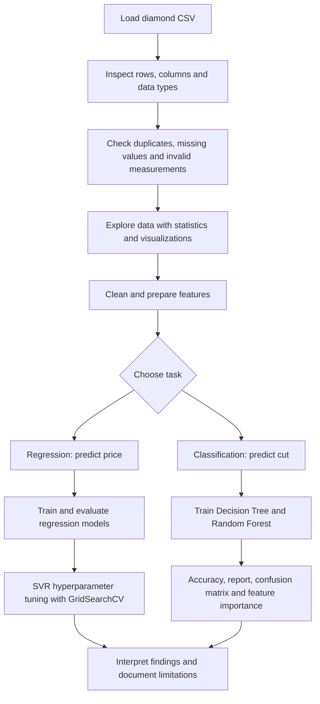

<!--
Project: AI-Powered Diamond Analysis & Machine Learning
Repository: azhar-data/Nexskill_project
-->

<div align="center">

# 💎 AI-Powered Diamond Analysis & Machine Learning

### Explore diamond characteristics • Understand price drivers • Predict prices • Classify cut quality

<p>
  
  
  
  
</p>

**A practical data science project developed with the diamonds dataset to investigate gemstone attributes, build machine-learning models, and evaluate regression and classification performance.**

</div>

---

## 📌 Table of Contents

- [Project Overview](#-project-overview)
- [Project Objectives](#-project-objectives)
- [Dataset Description](#-dataset-description)
- [Machine-Learning Tasks](#-machine-learning-tasks)
- [Project Workflow](#-project-workflow)
- [Exploratory Data Analysis](#-exploratory-data-analysis)
- [Data Preparation](#-data-preparation)
- [Models and Evaluation](#-models-and-evaluation)
- [Project Structure](#-project-structure)
- [Installation](#-installation)
- [How to Run](#-how-to-run)
- [Interpreting the Results](#-interpreting-the-results)
- [Current Limitations and Future Improvements](#-current-limitations-and-future-improvements)
- [Learning Outcomes](#-learning-outcomes)
- [Author](#-author)

---

## 💎 Project Overview

The **AI-Powered Diamond Analysis & Machine Learning** project explores how a diamond's physical measurements and quality characteristics relate to its price and cut category. It combines data cleaning, exploratory data analysis (EDA), visualization, feature preparation, supervised learning, model evaluation, and hyperparameter tuning in Python.

The project contains two complementary machine-learning tasks:

1. **Diamond price prediction (regression):** estimates a diamond's price from its available characteristics.
2. **Diamond cut classification (classification):** predicts a diamond's cut category using its other recorded attributes.

The goal is not simply to train a model. The workflow also examines data quality, studies relationships between variables, compares algorithms, and uses evaluation metrics to understand how well the models generalize to unseen records.

> **Important:** Model predictions are estimates learned from the supplied dataset. They are not certified gemological valuations, live market quotes, or guarantees of a diamond's selling price.

## 🎯 Project Objectives

- Load and inspect a structured diamond dataset with Pandas.
- Understand feature distributions, data types, summary statistics, and missing values.
- Identify duplicate records and investigate physically implausible measurements.
- Explore relationships between carat, dimensions, depth, table, cut, color, clarity, and price.
- Prepare categorical variables for machine-learning algorithms.
- Separate input features (**X**) from the target (**y**).
- Train and compare regression models for price estimation.
- Train classification models for predicting cut categories.
- Evaluate model performance with appropriate metrics.
- Tune Support Vector Regression (SVR) hyperparameters with cross-validation.
- Practice building a reproducible, clearly documented machine-learning workflow.

## 📊 Dataset Description

The main data file is **`10-diamonds.csv`**. The source dataset is commonly known as the diamonds dataset and contains measurements and quality categories for individual diamonds.

The original dataset is commonly distributed with **53,940 records and 10 meaningful variables**, sometimes accompanied by an extra index column. The exact number of rows in the processed data may be lower after duplicate removal and data-quality filtering.

### Feature dictionary

| Feature | Type | Description |
|---|---|---|
| `carat` | Numeric | Diamond weight in carats. |
| `cut` | Categorical | Cut-quality category; used as the classification target in the classification script. |
| `color` | Categorical | Diamond color grade. |
| `clarity` | Categorical | Clarity grade describing inclusions and blemishes. |
| `depth` | Numeric | Total depth percentage. |
| `table` | Numeric | Width of the diamond's top facet relative to its widest point, expressed as a percentage. |
| `price` | Numeric | Recorded price in the dataset; used as the regression target. |
| `x` | Numeric | Length in millimeters. |
| `y` | Numeric | Width in millimeters. |
| `z` | Numeric | Depth in millimeters. |

### Why these variables matter

- **Carat:** weight is often strongly associated with price, although the relationship is not necessarily linear.
- **Cut, color, and clarity:** quality categories can contribute to differences in recorded price.
- **Dimensions and proportions:** measurements may help describe size and shape, and can reveal invalid records.
- **Price:** the numerical target for the regression task.
- **Cut:** the categorical target for the classification task.

The data describes associations in the dataset. It does not, by itself, prove that any one characteristic causes a particular price.

## 🧠 Machine-Learning Tasks

### Task 1 — Diamond Price Prediction

**Script:** `01_data_Analysis_reggression.py`

This is a supervised **regression** task because the target, `price`, is numeric.

- **Input features (X):** diamond characteristics other than price.
- **Target (y):** `price`.
- **Algorithms explored:** Linear Regression, XGBoost Regressor, and Support Vector Regression (SVR).
- **Validation approach:** a train/test split, followed by GridSearchCV for SVR hyperparameter tuning.
- **Evaluation:** R², Mean Absolute Error (MAE), Mean Squared Error (MSE), Root Mean Squared Error (RMSE), and Mean Absolute Percentage Error (MAPE).

The purpose is to compare model behavior and measure how closely predictions match recorded prices on held-out data.

### Task 2 — Diamond Cut Classification

**Script:** `02_classification_method.py`

This is a supervised **classification** task because the target, `cut`, is a category.

- **Input features (X):** the remaining diamond attributes, excluding `cut`.
- **Target (y):** `cut`.
- **Algorithms explored:** Decision Tree Classifier and Random Forest Classifier.
- **Evaluation:** accuracy, classification report, confusion matrix, and Random Forest feature importance.

Classification accuracy alone may not tell the full story if some cut categories occur more frequently than others. Precision, recall, F1-score, and class-wise errors should also be considered.

## 🔄 Project Workflow

The project follows this general workflow:



### 1. Data loading and inspection

Pandas loads the CSV file. The scripts inspect data types, dataset dimensions, summary statistics, and missing values to understand the dataset before modeling.

### 2. Data cleaning

The regression workflow removes duplicate records, removes an extra index column when present, and filters measurements considered implausible by the current script. These choices affect which records remain and should be reviewed before using the model for any real-world decision.

### 3. Exploratory data analysis

Plots help reveal relationships, distributions, outliers, and potential patterns. Visual inspection is useful, but any filtering thresholds should also be justified with domain knowledge rather than chosen only because a point looks unusual.

### 4. Feature preparation

Categorical variables must be converted into a representation that the chosen model can use. Numeric features are standardized in the regression workflow, particularly for SVR, which is sensitive to feature scale.

### 5. Model training

The dataset is split into training and testing portions. The training set is used to fit the model; the test set is reserved for a final estimate of performance on unseen data.

### 6. Evaluation and interpretation

Metrics and diagnostic outputs are used to compare predictions with actual targets, identify errors, and understand the strengths and limitations of each approach.

## 🔎 Exploratory Data Analysis

Useful analysis questions for this dataset include:

- How does price change as carat weight increases?
- Do diamonds with similar carat weights have different prices across cut, color, or clarity grades?
- How are depth and table percentages distributed?
- Are there zero or implausible values in the physical dimensions?
- Which numeric features are strongly correlated with price?
- Which input features are most useful for predicting cut?

### Suggested visualizations

| Visualization | What it helps investigate |
|---|---|
| Carat vs. price scatter plot | Relationship between diamond weight and recorded price. |
| Price distribution / histogram | Skewness, concentration, and unusually high prices. |
| Box plots by cut, color, or clarity | Price differences across quality categories and potential outliers. |
| Correlation heatmap | Linear relationships among numeric variables. |
| Actual vs. predicted price plot | How closely regression predictions follow observed prices. |
| Confusion matrix | Which cut categories the classifier confuses most often. |
| Feature-importance chart | Which input features the fitted Random Forest relies on most. |

The scripts include plotting code, including pair plots and scatter plots. Some plots can take time to render because the dataset contains tens of thousands of rows.

## 🧹 Data Preparation

The existing scripts demonstrate several common preprocessing techniques.

### Duplicate and missing-value checks

Duplicate records are removed in the regression workflow, and missing-value counts are printed. Missingness should be investigated before choosing a strategy: dropping rows is not always the best choice, especially when missing values are meaningful or numerous.

### Invalid measurements and outliers

The regression script filters zero dimensions and applies ranges to `z`, `y`, `table`, and `depth`. These filters are part of the current exploratory workflow, not universal gemological rules. Record the number of rows removed and validate the thresholds before relying on the results.

### Encoding categorical variables

The regression workflow encodes `cut`, `color`, and `clarity` for the models. The classification workflow encodes `color` and `clarity` while retaining `cut` as the target.

**Potential improvement:** `LabelEncoder` assigns integer codes to categories. For nominal input features, `OneHotEncoder` inside a scikit-learn pipeline is often a safer default because it avoids implying that the numerical codes represent meaningful distances or ordering.

### Feature scaling

The regression script uses `StandardScaler` to standardize features. The scaler is fitted on training data and then applied to test data, which is the correct direction for avoiding test-set information leaking into preprocessing.

**Further improvement:** use a `Pipeline` and `ColumnTransformer` so encoding and scaling are fitted within each cross-validation fold, and so the same transformations are consistently applied at prediction time.

## 🤖 Models and Evaluation

### Regression metrics

| Metric | What it means | Preferred direction |
|---|---|---|
| **R²** | How much target variation the model explains relative to a simple baseline. | Higher is generally better; it can be negative. |
| **MAE** | Average absolute prediction error in the target's units. | Lower is better. |
| **MSE** | Average squared prediction error; large errors receive a heavier penalty. | Lower is better. |
| **RMSE** | Square root of MSE, expressed in the target's units. | Lower is better. |
| **MAPE** | Average absolute percentage error. | Lower is better, but it can be unstable when actual values are zero or close to zero. |

**Linear Regression** provides a useful baseline. **XGBoost Regressor** can capture nonlinear relationships and feature interactions. **SVR** can model nonlinear patterns through kernels, but training and hyperparameter searches can be computationally expensive on large datasets.

### Classification metrics

| Metric | What it means |
|---|---|
| **Accuracy** | Fraction of predictions that are correct. |
| **Precision** | Among predictions for a class, the fraction that are correct. |
| **Recall** | Among actual examples of a class, the fraction found by the model. |
| **F1-score** | Harmonic mean of precision and recall. |
| **Confusion matrix** | Counts correct and incorrect predictions by actual and predicted class. |
| **Feature importance** | A model-specific indication of how much features contributed to the fitted Random Forest's decisions. |

The classification script compares a Decision Tree with a Random Forest and prints detailed diagnostics for the Random Forest. Results should be measured on held-out data and, where possible, checked with stratified cross-validation.

### Hyperparameter tuning

The regression script uses **GridSearchCV** to explore SVR settings such as kernel, `C`, and `gamma`. Cross-validation evaluates candidate settings across multiple training folds and selects the best candidate according to the configured scoring method.

A large parameter grid can require substantial compute. Start with a smaller search or a representative sample when experimenting, then expand after confirming the workflow runs correctly.

> **Reproducibility note:** The scripts are the source of truth for the implemented workflow. No performance score is reported here because results should be generated in the current environment and verified rather than guessed.

## 🗂️ Project Structure

Expected files in this project folder:

```text
1 Project diamond file/
├── README.md
├── 10-diamonds.csv
├── 01_data_Analysis_reggression.py
└── 02_classification_method.py
```

- **`README.md`** — project documentation, setup guidance, workflow, and interpretation.
- **`10-diamonds.csv`** — dataset used for analysis and modeling.
- **`01_data_Analysis_reggression.py`** — exploratory analysis, cleaning, regression models, metrics, and SVR tuning.
- **`02_classification_method.py`** — cut classification with Decision Tree and Random Forest models.

## ⚙️ Installation

### Requirements

- Python 3.10 or later is recommended.
- pip package installer.
- VS Code, Jupyter, or another Python environment.
- The `10-diamonds.csv` dataset included in this folder.

### 1. Clone the repository

```bash
git clone https://github.com/azhar-data/Nexskill_project.git
cd Nexskill_project
```

### 2. Open the project folder

Open `1 Project diamond file` in VS Code, or change into it in your terminal:

```bash
cd "1 Project diamond file"
```

### 3. Create and activate a virtual environment (recommended)

**Windows PowerShell:**

```powershell
python -m venv .venv
.\.venv\Scripts\Activate.ps1
```

**Windows Command Prompt:**

```bat
python -m venv .venv
.venv\Scripts\activate.bat
```

**macOS / Linux:**

```bash
python3 -m venv .venv
source .venv/bin/activate
```

### 4. Install dependencies

```bash
python -m pip install --upgrade pip
pip install pandas numpy matplotlib seaborn scikit-learn xgboost
```

## ▶️ How to Run

Run commands from inside `1 Project diamond file`.

### Run the regression workflow

```bash
python 01_data_Analysis_reggression.py
```

### Run the classification workflow

```bash
python 02_classification_method.py
```

### Important: check the CSV paths first

The current scripts refer to different folder paths for the CSV file. Since the dataset is stored alongside the scripts in this project folder, update the `read_csv` lines to:

```python
df = pd.read_csv("10-diamonds.csv")
```

Use this path in each script so the code works when launched from the project folder. Alternatively, keep the original paths only if your local folder structure matches them exactly.

The scripts open Matplotlib/Seaborn plots and print metrics to the terminal. The regression script's pair plots and SVR/GridSearchCV stages may take a while. If execution is slow, first test the cleaning and baseline model stages, then run expensive model searches separately.

## 📈 Interpreting the Results

For regression, compare models using the same test set and inspect both R² and error metrics. A high R² does not automatically mean predictions are sufficiently accurate for every price range. Plot actual prices against predicted prices and inspect errors across low-, medium-, and high-price examples.

For classification, do not rely on accuracy alone. Check the classification report and confusion matrix to see which cut categories are predicted reliably. Inspect feature importance as a model-specific diagnostic, not proof that a feature causes a cut grade.

Any preprocessing decisions—including outlier removal, category encoding, and feature selection—can change the final results. Keep the test set separate until model selection is complete, and avoid using test-set results to repeatedly tune the model.

## 🚀 Current Limitations and Future Improvements

The project can be extended into a more robust, portfolio-ready application through the following steps:

- [ ] **Fix and centralize data paths** using paths relative to the script location.
- [ ] **Build preprocessing pipelines** with `ColumnTransformer`, `OneHotEncoder`, and `StandardScaler`.
- [ ] **Use cross-validation consistently** for fair model comparison and model selection.
- [ ] **Add a baseline model** and compare all models against it.
- [ ] **Report final test metrics** in a small comparison table after actually running the experiments.
- [ ] **Improve outlier handling** by documenting thresholds and recording how many rows each filter removes.
- [ ] **Add residual analysis** and error breakdowns by carat and price range.
- [ ] **Check target leakage and feature importance** carefully, particularly for correlated size measurements.
- [ ] **Save trained models and preprocessing pipelines** using a reproducible artifact format.
- [ ] **Create a Streamlit dashboard** for interactive charts and sample price predictions.
- [ ] **Add input validation and clear error messages** for invalid or unrealistic user inputs.
- [ ] **Add automated tests** for data loading, preprocessing, and prediction.
- [ ] **Document the dataset source and license** clearly in the repository.

### Possible next-stage application

A future dashboard could let users enter carat, cut, color, clarity, dimensions, depth, and table values; receive a model-estimated price; compare model predictions; and explore feature relationships through interactive charts. Such a dashboard would be an extension of the current scripts, not a feature claimed to already exist.

## 🎓 Learning Outcomes

This project provides practical experience with:

- Python-based data analysis using Pandas and NumPy.
- Data visualization with Matplotlib and Seaborn.
- Data cleaning and exploratory data analysis.
- Regression versus classification and target selection.
- Encoding categorical features and scaling numerical features.
- Train/test splitting and generalization to unseen data.
- Linear Regression, XGBoost, SVR, Decision Trees, and Random Forests.
- Regression metrics and classification diagnostics.
- Cross-validation and hyperparameter tuning.
- Reproducible workflows, project documentation, and identifying future improvements.

## 👨‍💻 Author

**Muhammad Azhar**  
AI / Machine Learning Learner | Python | Data Analysis | Supervised Learning

- GitHub: [@azhar-data](https://github.com/azhar-data)
- Repository: [Nexskill_project](https://github.com/azhar-data/Nexskill_project)

---

<div align="center">

**Built as a hands-on machine-learning project for learning, experimentation, and portfolio development.**

⭐ If you find this project useful, consider starring the repository.

</div>
